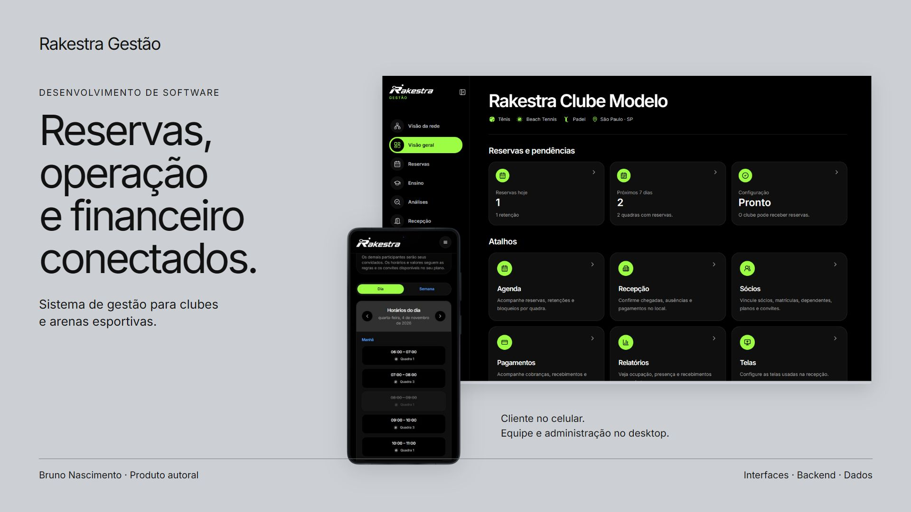

# Rakestra Gestão

Sistema de gestão para clubes e arenas esportivas: reservas, atendimento, atividades e financeiro conectados.



O produto reúne a operação do estabelecimento e a experiência pública de reserva. A apresentação cobre os módulos do sistema; este repositório disponibiliza oito módulos executáveis selecionados, cinco arquivos de referência do backend, documentação e testes reproduzíveis.

**Bruno Nascimento:** concepção do produto, fluxos e direção visual; construção com desenvolvimento assistido por IA, definição e revisão das funcionalidades.

## Começar

Requisito: **Node.js 24.12 ou superior**. Os testes usam a execução nativa de TypeScript e não exigem instalação de pacotes.

```sh
npm test
npm run demo
```

O exemplo consulta disponibilidade, confere uma cotação e avalia o acesso de um operador com dados fictícios em memória. Ele não cria reservas, não envia requisições e não realiza cobranças.

## Conhecer o produto

| Parte | Papel no conjunto |
|---|---|
| Agenda e reservas | Disponibilidade de quadras, ocupação e confirmação. |
| Site público | Busca, escolha e acompanhamento pelo cliente. |
| Recepção | Chegada, presença, atendimento e pendências. |
| Sócios | Planos, vínculos, dependentes e condições de acesso. |
| Ensino | Professores, alunos, serviços e programação. |
| Competições | Torneios, categorias, confrontos e ranking interno. |
| Financeiro | Origem de cobranças, recebimentos, pacotes e análises. |
| Administração | Equipe, unidades, regras, site público e comunicações. |

A [apresentação completa](docs/product.md) percorre esses módulos. O [guia de leitura](docs/modules/README.md) liga os capítulos às evidências, e a [arquitetura](docs/architecture/README.md) explica interfaces, serviços e dados.

## Examinar a implementação

- [Disponibilidade e disputa por horário](docs/decisions/disponibilidade.md).
- [Preço e origem da cobrança](docs/decisions/financeiro.md).
- [Acesso por clube e unidade](docs/decisions/acesso.md).
- [Identificação e recuperação de operações](docs/decisions/recuperacao.md).

Os arquivos em [src](src) conservam a lógica dos módulos selecionados. O manifesto [sources.json](sources.json) identifica os arquivos originais, os hashes e as adaptações de importação.

Os arquivos em [reference](reference) são cópias inalteradas de partes do backend. Dependem dos modelos, aliases, bibliotecas e ambiente do produto completo; não são executados por este pacote. Eles permitem consultar o tratamento de ocupação, confirmação, acesso e recuperação além dos contratos do cliente.

## Verificações desta edição

Os **24 testes passaram** em 04/11/2026 com Node.js 24.14.0, no Windows. O [registro TAP](evidence/tests.tap) e o [resumo de execução](evidence/verification.json) conservam o resultado.

| Grupo | Cenários | Alcance |
|---|---:|---|
| Agenda e tempo | 8 | Sobreposição, horários consecutivos, quadras inativas, fuso e histórico. |
| Acesso e contexto | 7 | Capacidade, liberação, permissão, unidade e navegação. |
| Cotação e cobrança | 9 | Centavos inteiros, consistência dos valores e identidade da operação consultada. |

Os testes exercitam funções selecionadas em memória. Eles não executam o backend de referência, a disputa transacional no banco, pagamentos ou o percurso completo em um dispositivo. O comando executa comportamento e não faz verificação estática de tipos.

## Interfaces e estado

As capturas mostram ambientes demonstrativos e controlados de desenvolvimento em 2026. Nomes de teste, valores, datas e indicadores pertencem aos cenários. Elas apresentam a interface e não representam resultados comerciais ou aprovação funcional global.

A gestão web é a experiência principal desta edição. O site público aparece no mock de celular aprovado para o Rakestra. O Gestão Mobile tem contexto profissional próprio; a arquitetura o identifica como uma interface separada, com capacidades da sua versão, sem pressupor equivalência integral ao desktop.

Na versão capturada do módulo de sócios, a própria interface informa que a mensalidade não é cobrada nessa área. Os planos e vínculos continuam apresentados com esse limite.

## Organização

| Caminho | Conteúdo |
|---|---|
| docs/modules | Visão dos módulos e relações de uso. |
| docs/architecture | Responsabilidades das interfaces, API e dados. |
| docs/decisions | Situação, escolha, consequências e verificações. |
| src | Oito módulos executáveis extraídos. |
| reference | Cinco arquivos inalterados do backend para consulta. |
| tests e examples | Cenários comportamentais e exemplo em memória. |
| evidence | Resultado e alcance das verificações. |
| media | Capturas selecionadas e diagrama da apresentação. |

[Portfólio de Bruno Nascimento](https://bruniversamente.github.io/) · [Rakestra App: produto e engenharia](https://github.com/bruniversamente/rakestra-app-engineering)
