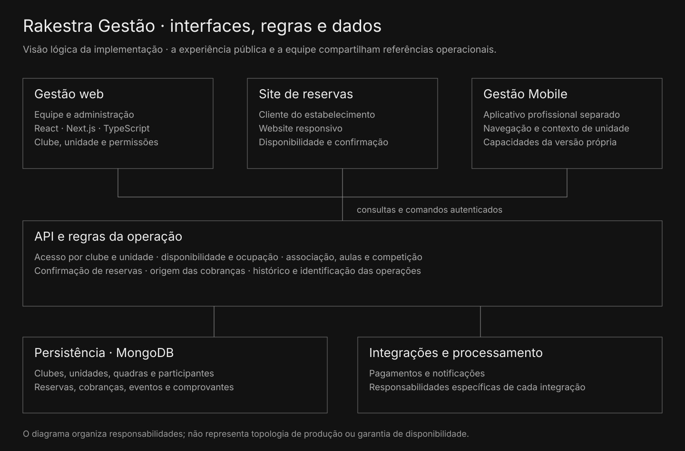

# Arquitetura e dados

A gestão web utiliza React, Next.js e TypeScript. O site público atende a experiência de reserva. O Gestão Mobile possui navegação profissional própria; o aplicativo do atleta mantém suas experiências sociais e esportivas.

A API verifica identidade, vínculo e permissão antes de executar a operação pertinente. O MongoDB conserva os registros. Pagamentos e notificações acrescentam integrações e processamento, com responsabilidades específicas.

## Relações principais

- Organização, clube e unidade situam o contexto de operação.
- Quadra e período situam a ocupação.
- Responsável e participantes situam a reserva ou atividade.
- Plano e vínculo definem condições de associação.
- Fatura, recebimento e devolução conservam a origem financeira.
- Funcionário, função e unidade autorizada delimitam o acesso.

## O que o pacote executa

Os oito módulos em `src` não acessam serviços externos. As únicas adaptações são os caminhos das importações. Consulte [sources.json](../../sources.json).

O código em `reference` conserva dependências e aliases do servidor original e serve para consulta. Ele não pode ser executado como um backend independente. O diagrama é lógico e não representa topologia ou disponibilidade de produção.
