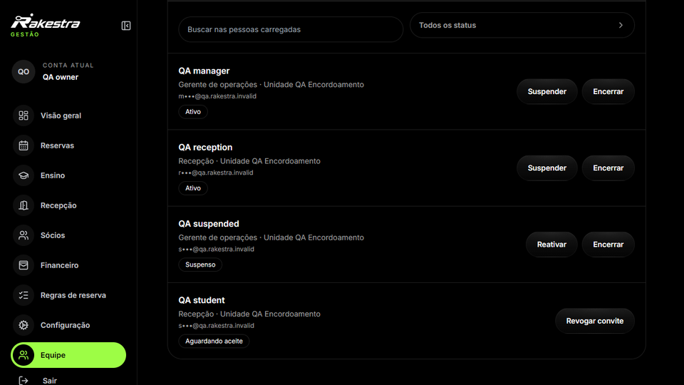
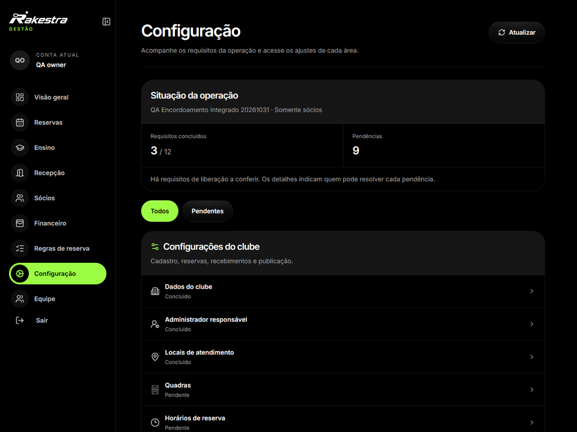
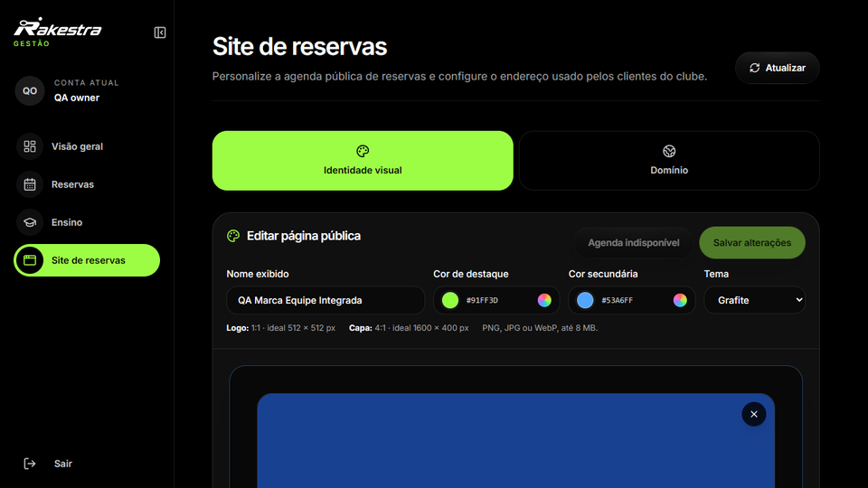
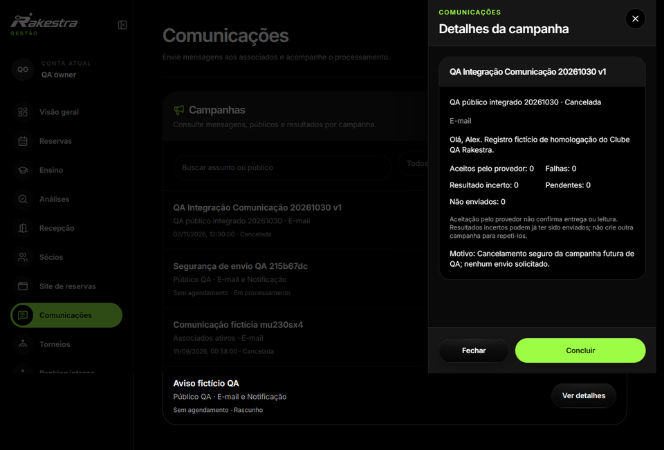

# Contexto profissional, permissões e configuração

O profissional entra no contexto de gestão e atua conforme seu vínculo, suas permissões e suas unidades autorizadas. Ter acesso à agenda não significa poder consultar todo o financeiro ou administrar a equipe.

A navegação aplica requisitos de capacidade, liberação operacional e permissão. O backend repete as verificações pertinentes antes das operações; ocultar uma entrada na interface não substitui essa autorização.

Convite profissional, função e contexto de atuação.

Acesso às configurações de operação e equipe.

A configuração do clube inclui unidades e recursos, regras de uso e apresentação pública. A personalização do site de reservas conecta a identidade do estabelecimento à experiência do cliente. Comunicações e interfaces do local completam a administração conforme as capacidades disponíveis.

Personalização da apresentação pública do estabelecimento.

Detalhes e estado de uma campanha no ambiente controlado.
