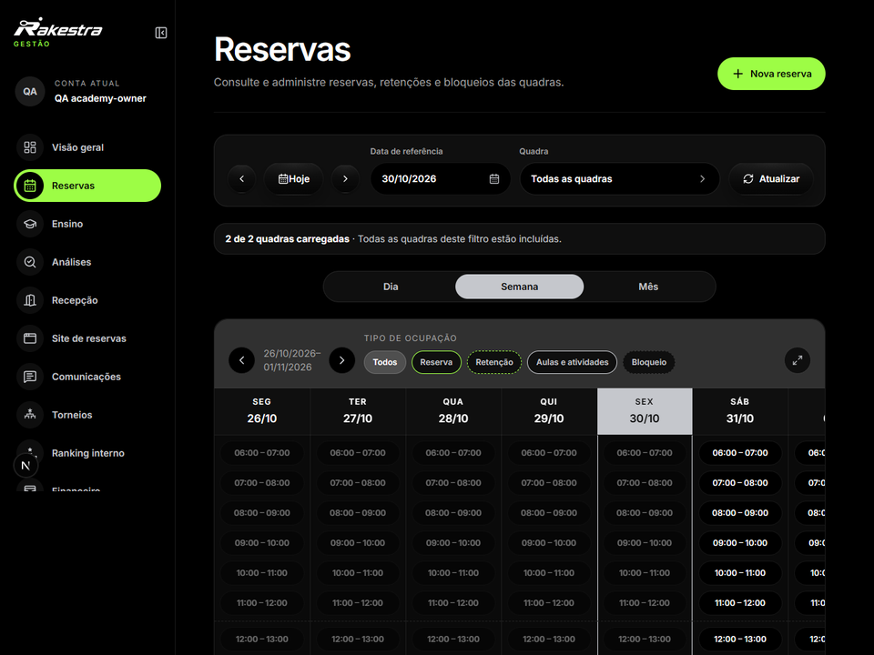

# Uma agenda compartilhada por atividades diferentes

Uma quadra pode receber uma reserva, uma aula ou um bloqueio de operação. A consulta precisa considerar a unidade, a quadra e o intervalo de tempo, incluindo ocupações parciais e horários consecutivos.

O cliente consulta as opções disponíveis; a confirmação depende das regras do servidor. A implementação relaciona retenções temporárias, ocupação da agenda e criação da reserva, conferindo também quem pode executar a operação.

Reservas, bloqueios e horários na agenda do estabelecimento.

O exemplo no portfólio utiliza `getAvailableScheduleCourtIds`. O pacote permite examinar a função em [src/management-schedule-availability.ts](../../src/management-schedule-availability.ts) e executá-la com `npm run demo`. A confirmação de uma reserva depende do servidor.

O exemplo executa uma função compartilhada do produto sobre dados fictícios. Ele mostra como a consulta exclui quadras ocupadas ou fora de operação. A disputa entre gravações simultâneas e a confirmação transacional pertencem ao backend, cuja implementação está documentada no repositório.
