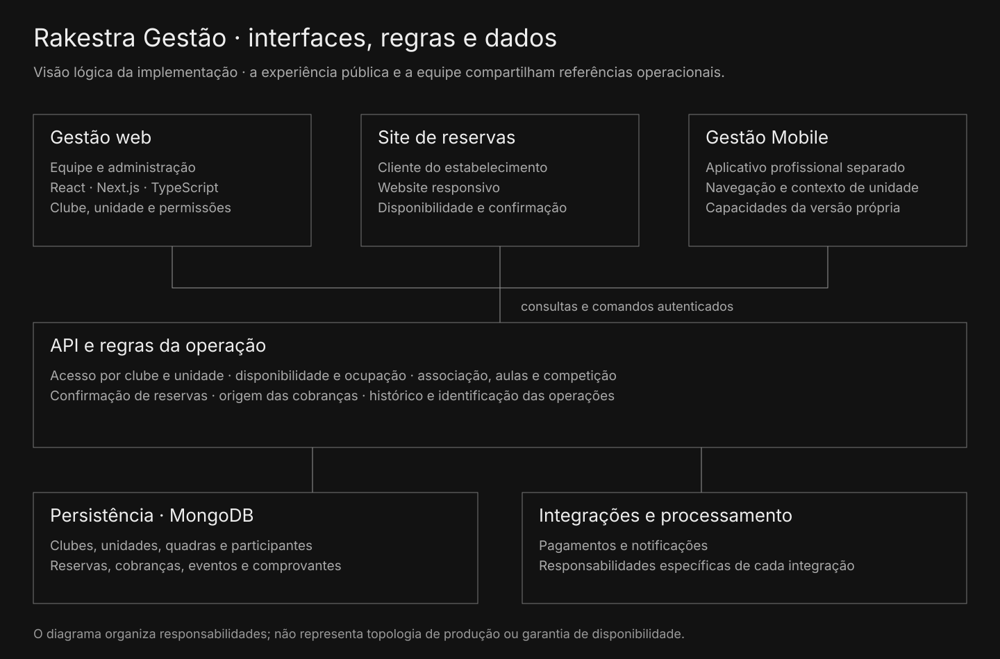

# Interfaces diferentes, responsabilidades compartilhadas

A gestão web utiliza React, Next.js e TypeScript. O site público atende o cliente do estabelecimento. O Gestão Mobile tem entrada e navegação profissionais próprias, separadas do aplicativo social do atleta.

A API concentra regras e acesso aos registros persistidos em MongoDB. Identidades de clube, unidade, quadra e participante conectam agenda, reservas, atividades e financeiro.

Visão lógica das interfaces, da API, das regras e da persistência.

| Parte | Responsabilidade |
| --- | --- |
| Gestão web | Operação e administração pelo profissional. |
| Site público | Consulta e reserva pelo cliente em interface responsiva. |
| Gestão Mobile | Experiência profissional com contexto e capacidades da versão mobile. |
| API e regras | Autorizar ações, conferir condições e registrar efeitos. |
| Dados e integrações | Persistência, histórico, pagamentos e processamento associado. |

Uma reserva liga o responsável à quadra e ao período; os registros financeiros conservam a origem da obrigação. A equipe opera dentro de clube e unidade. Esse mapa explica a função das referências que reaparecem nas telas e nos validadores.
