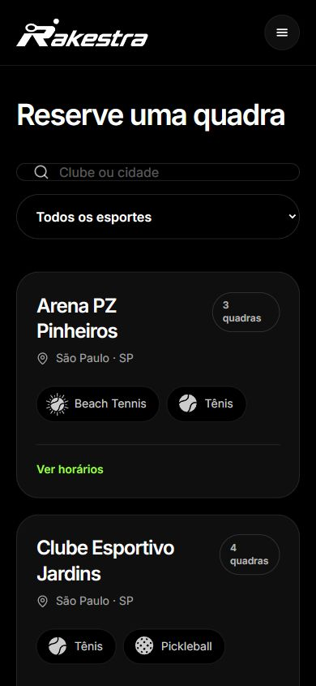
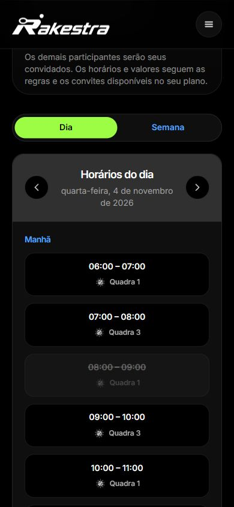
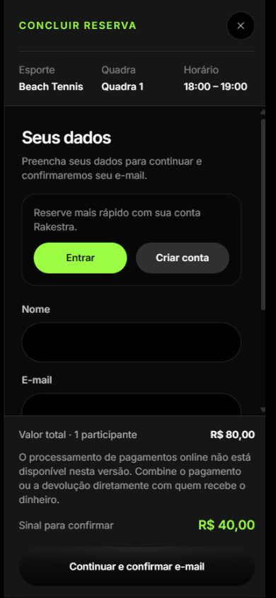
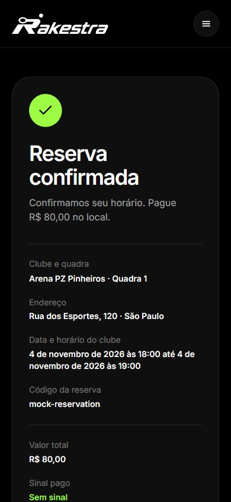

# Do horário disponível ao acompanhamento da reserva

O site público do clube oferece a busca por estabelecimento e a escolha das condições do encontro. No celular, o cliente consulta data, modalidade, quadra e horário, informa os dados necessários e acompanha o resultado da solicitação.

As telas preservam o contexto da escolha durante a passagem para identificação e confirmação. O valor total, o sinal e o saldo no local têm significados próprios. O contrato da cotação associa os valores à quadra, ao responsável, ao período e à versão da regra.

Busca pública · clube ou cidade, modalidade e acesso aos horários.

Dia · horários agrupados por período; intervalos indisponíveis permanecem identificados.

Reserva · o painel mantém a escolha visível e reúne identificação e condições.

Confirmação · exemplo sem sinal, com R$ 80,00 a pagar no local.

Estas capturas apresentam o website responsivo dentro do mock de celular aprovado para o Rakestra. A confirmação demonstrativa mostra um exemplo sem sinal, com valor a pagar no local. A reserva e sua situação podem então ser consultadas pela equipe.
