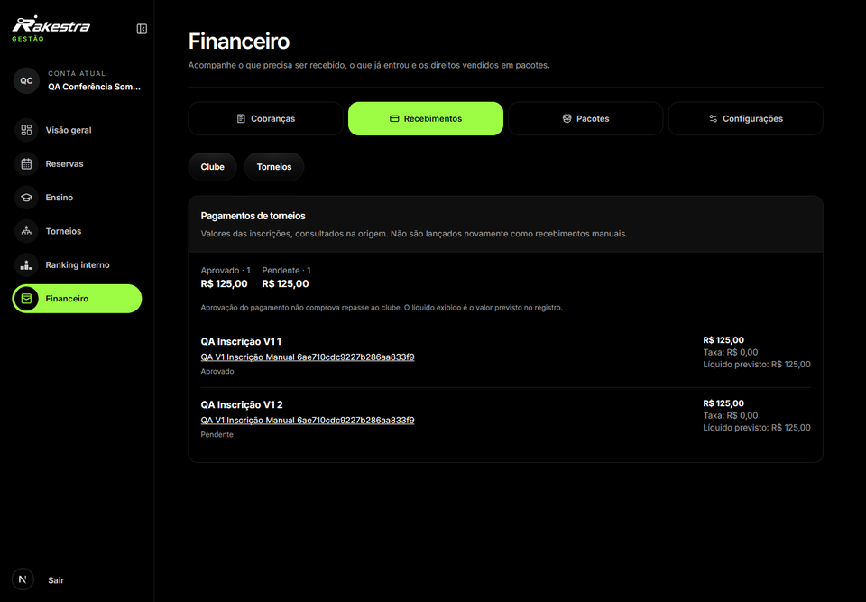
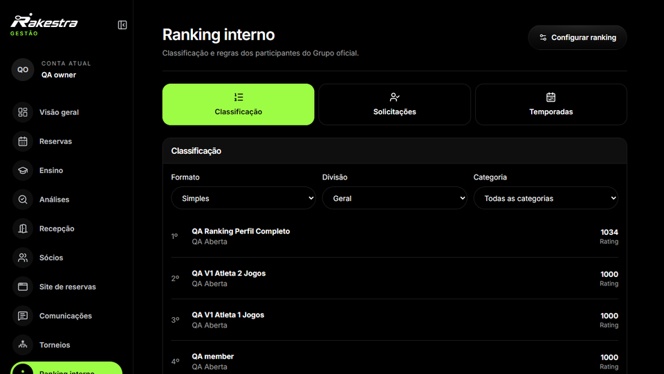

# Organizar categorias, participação e resultados

A administração de torneios reúne categorias, participantes, confrontos e resultados. A competição tem sua própria estrutura de inscrições e decisões, conectada à consulta de quem participa.

O ranking interno também conserva categoria, formato e período. Uma classificação precisa ser lida dentro dessas regras; ela não equivale a qualquer indicador esportivo apresentado no perfil do atleta.

Inscrições consultadas na origem, com seus estados financeiros preservados.

Consulta da classificação no contexto da categoria.

A documentação identifica as áreas de torneios e ranking como módulos relacionados, com regras próprias. As telas deste capítulo mostram registros controlados de desenvolvimento.
