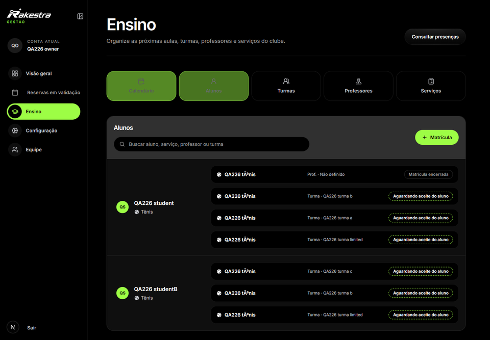
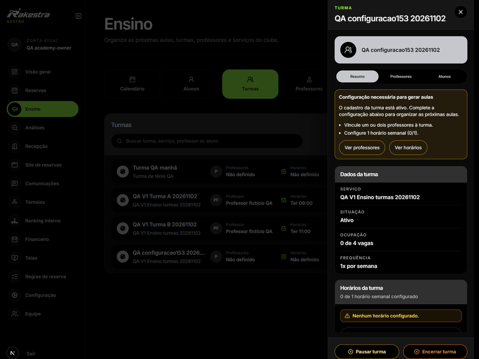

# Professores, alunos e espaços na mesma operação

O módulo de ensino reúne alunos, professores, serviços, turmas e programação. Uma atividade conecta participantes a um período e aos espaços necessários para sua realização.

A agenda ajuda a relacionar a atividade à ocupação das quadras. As informações de atendimento, presença e financeiro conservam o contexto do serviço em vez de tratar toda ocupação como uma reserva avulsa.

Consulta e acompanhamento de alunos no estabelecimento.

Professor, serviço e informações de uma atividade.

A gestão do estabelecimento e o painel individual do treinador têm responsabilidades diferentes no ecossistema. Aqui, o foco está na organização do ensino pelo clube e nas relações entre atividade, participantes e recursos.
