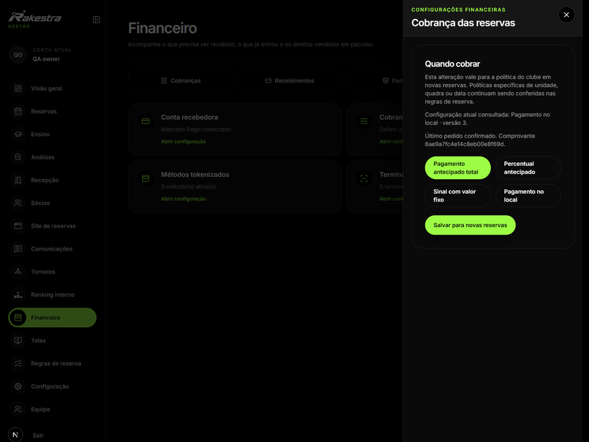
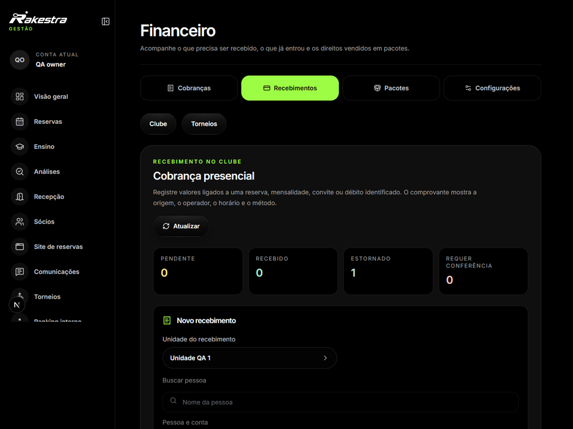
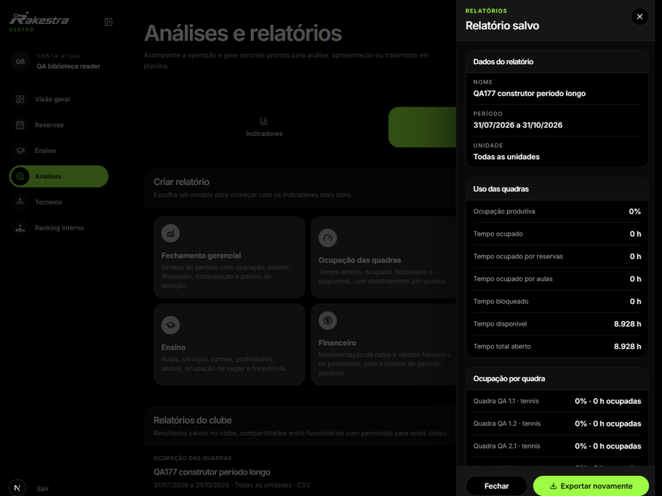

# Conservar a origem de cada valor

O financeiro precisa ligar o que o clube espera receber ao que foi cobrado e ao que foi registrado como pagamento. Reserva, fatura, recebimento e devolução têm identidades e estados diferentes.

O percurso da recepção carrega a origem da cobrança. O leitor de dados confere clube, reserva, tipo de obrigação, fatura e valores antes de aceitar a apresentação, evitando aproveitar uma resposta que pertença a outro contexto.

Definição da forma de cobrança e das condições da reserva.

Identificação da cobrança no percurso operacional.

| Informação | Leitura correta |
| --- | --- |
| Valor previsto | Condição calculada para uma escolha ou operação. |
| Cobrança | Obrigação identificada, com origem e saldo. |
| Recebimento | Pagamento registrado e relacionado à obrigação pertinente. |
| Relatório | Consulta com período, unidades e critérios definidos. |

Período, unidades e critérios do relatório operacional.

A leitura de um relatório depende do período e do critério escolhido. O valor recebido não substitui a receita prevista, e a ocupação disponível não representa atividade realizada. O repositório inclui testes do contrato monetário e da origem da cobrança; esses testes não efetuam pagamentos.
