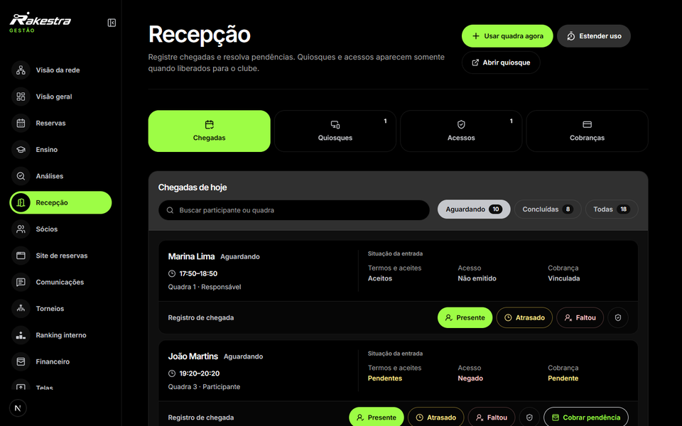

# Atender sem perder a referência do que aconteceu

A recepção organiza as chegadas, a presença e as pendências do dia. O funcionário precisa reconhecer a reserva, os participantes e a situação do atendimento antes de executar a ação adequada.

Presença, ocupação e pagamento são informações distintas. O percurso de cobrança conserva a identidade da reserva e da fatura para que o recebimento corresponda à obrigação consultada.

Chegadas, presença e pendências de atendimento.

| Parte da operação | Informação que precisa continuar identificada |
| --- | --- |
| Chegada e presença | Participante, reserva, quadra e contexto do atendimento. |
| Cobrança na recepção | Clube, unidade, reserva e origem do valor. |
| Serviços complementares | Ponto de venda e encordoamento têm capacidades e permissões próprias. |
| Interfaces do estabelecimento | Quiosque e telas têm configuração e responsabilidades específicas. |

O servidor trata cobranças presenciais com estados e registros próprios, incluindo confirmação e devolução. A apresentação técnica acompanha essas responsabilidades sem reduzir a operação a um botão de pagamento.
