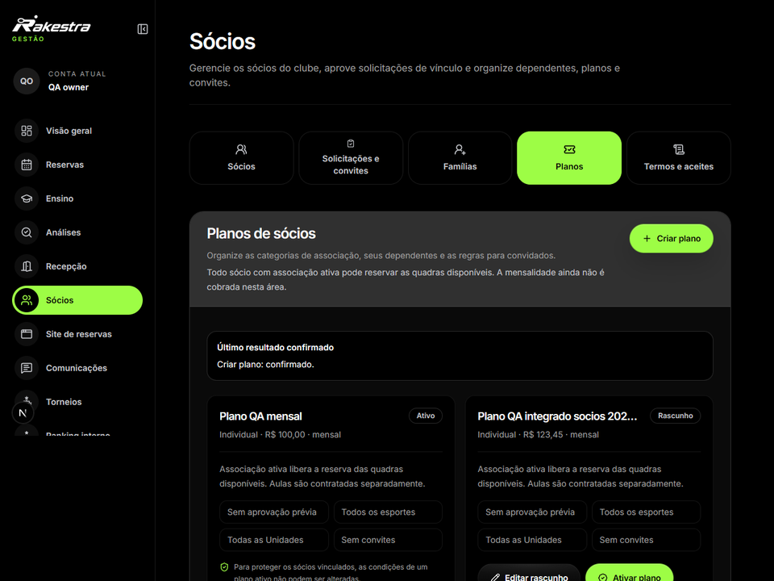
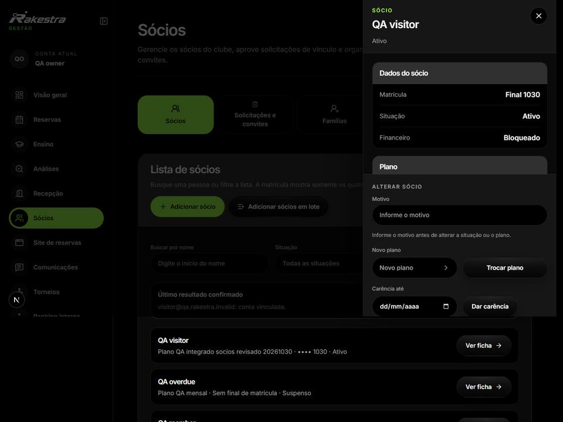

# Condições de acesso que acompanham a pessoa

A associação organiza o vínculo do cliente com o clube. Planos, validade, dependentes e convidados definem condições que precisam acompanhar as consultas e as operações pertinentes.

O módulo diferencia o plano configurado, o vínculo do sócio e os direitos aplicáveis. Alterar uma definição que já tem pessoas vinculadas exige preservar as condições e o histórico correspondentes.

Categorias de sócios, condições e estado do plano.

Identificação do vínculo e das condições de acesso.

Na versão registrada nas capturas, a associação ativa libera o uso das quadras nas condições do plano, enquanto aulas têm contratação separada. A própria interface informa que a mensalidade não é cobrada nessa área; o case conserva esse limite da versão.
